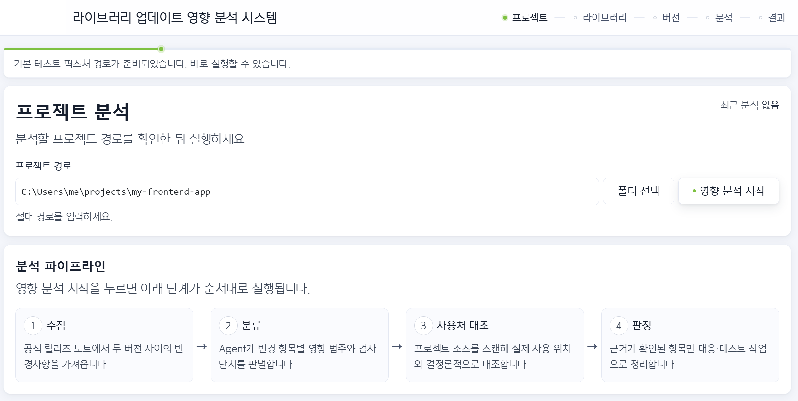
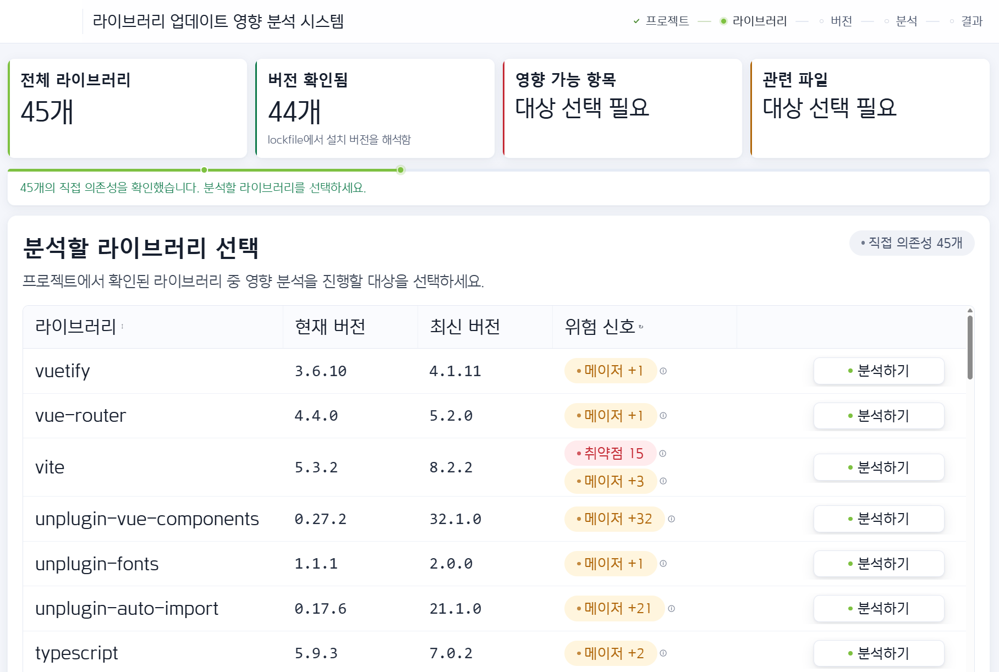
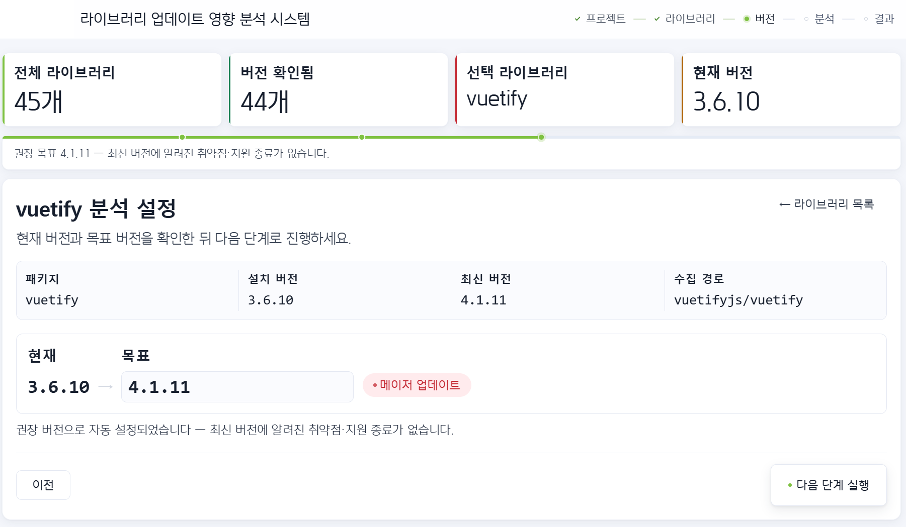
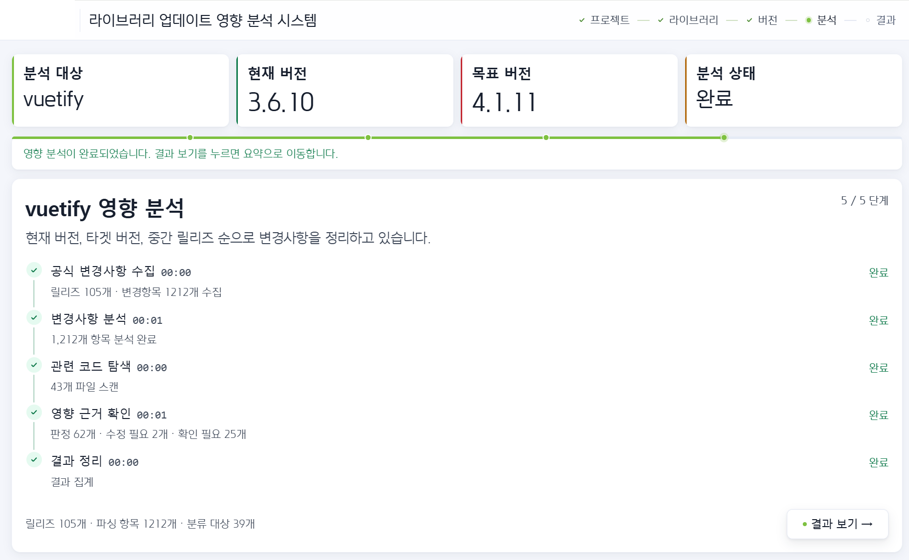
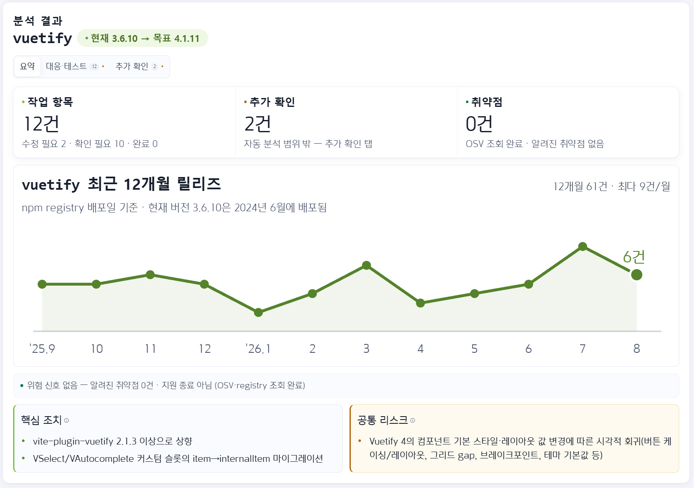
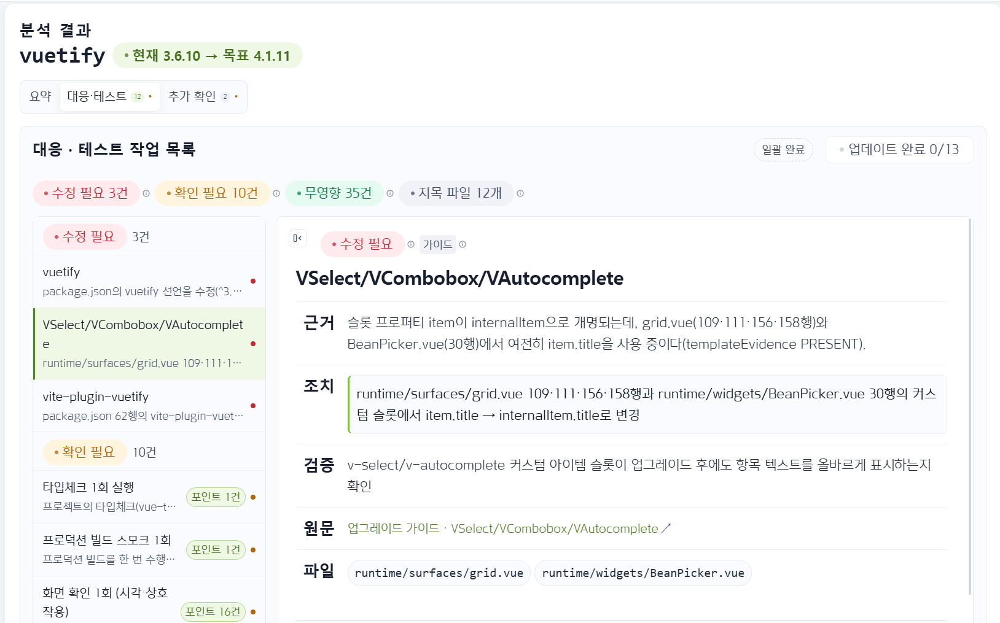
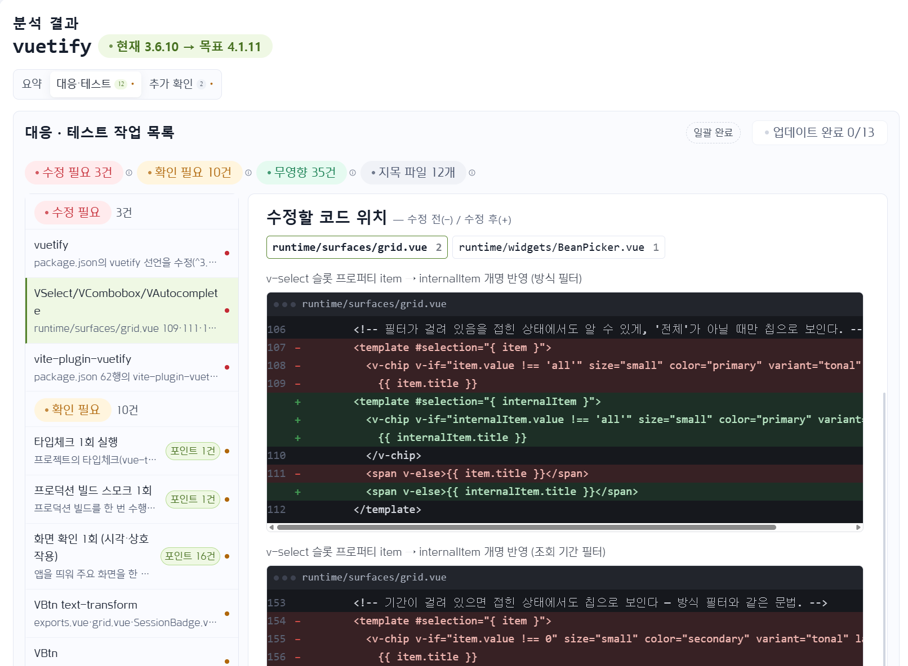
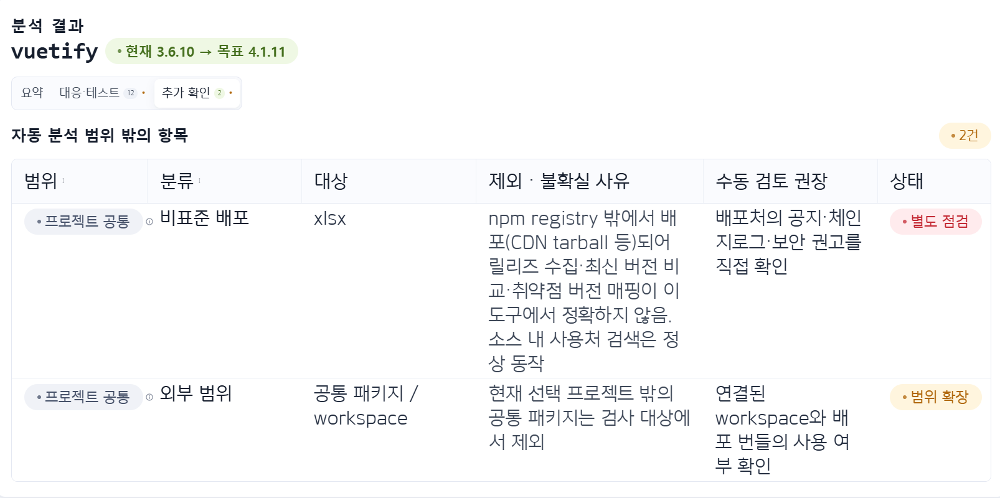
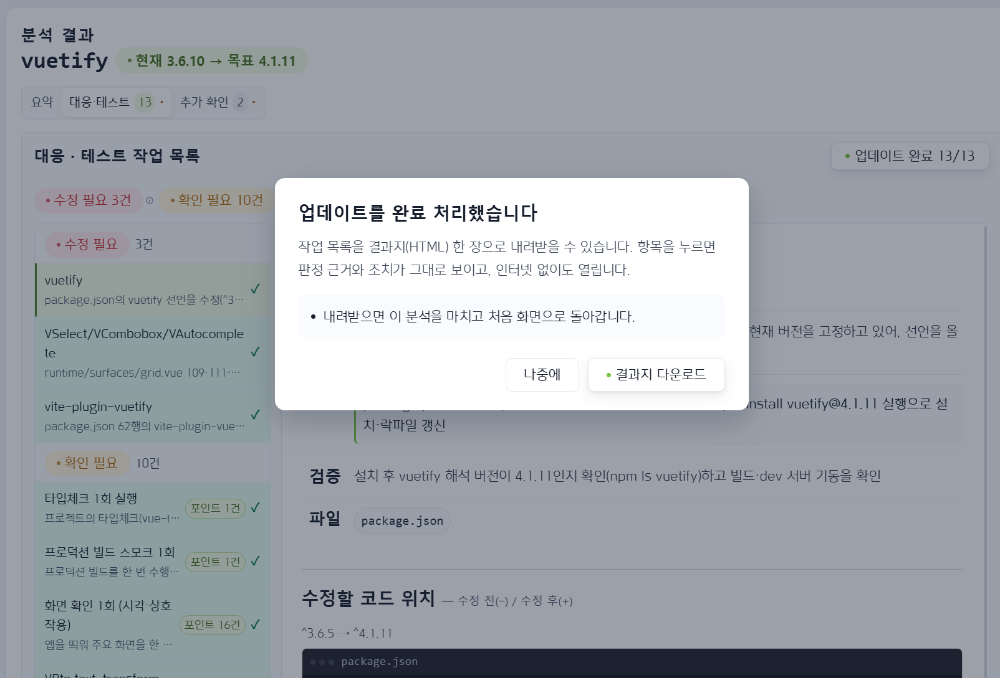
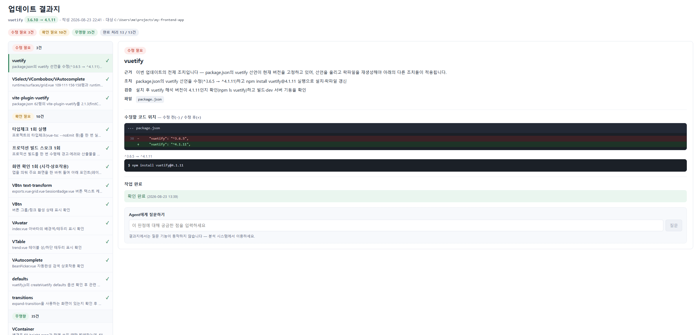

# lib-impact-analyzer

프로젝트가 쓰는 라이브러리를 새 버전으로 올릴 때, **내 프로젝트의 어느 코드가 영향을 받는지**를
릴리즈 노트에서 소스 코드까지 이어서 알려 주는 분석 도구입니다.

읽기 전용 분석 도구이며, 대상 프로젝트의 코드를 수정하지 않습니다.

## 무엇을 하나

업데이트 영향 분석은 보통 릴리즈 노트를 사람이 읽고, 프로젝트를 검색해 사용처를 찾고, 영향이
있는지 판단하는 수작업입니다. 이 도구는 그 과정을 네 단계로 나눠 자동화합니다.

| 단계 | 하는 일 |
|---|---|
| 1. 수집 | 공식 릴리즈 노트(atom · CHANGELOG · git)에서 두 버전 사이의 변경사항을 가져옵니다 |
| 2. 분류 | Agent가 변경 항목별 영향 범주와 검사 단서를 판별합니다 |
| 3. 사용처 대조 | 프로젝트 소스를 스캔해 실제 사용 위치와 결정론적으로 대조합니다 |
| 4. 판정 | 근거가 확인된 항목만 `수정 필요` / `확인 필요` / `무영향`으로 정리하고 작업 목록으로 만듭니다 |

판정은 추측이 아니라 확인된 근거(파일·행)에 기대고, 근거를 못 찾은 항목은 자동 분석 범위 밖으로
분리해 사람이 확인하도록 남깁니다.

## 화면

> 아래 화면은 샘플 프로젝트에서 `vuetify 3.6.10 → 4.1.11`을 분석한 예시입니다.

**1. 프로젝트 선택** — 분석할 프로젝트 경로를 입력합니다.



**2. 라이브러리 선택** — 직접 의존성 목록과 버전, 취약점·메이저 업데이트 같은 위험 신호를 보여 줍니다.



**3. 버전 선택** — 설치 버전은 lockfile에서 해석하고, 목표 버전은 권장 버전으로 채웁니다.



**4. 분석 진행** — 수집 → 분석 → 코드 탐색 → 근거 확인 → 결과 정리 순서로 진행됩니다.



**5. 요약** — 작업 항목 수, 취약점, 최근 릴리즈 추이와 핵심 조치·공통 리스크를 한눈에 봅니다.



**6. 대응·테스트 작업 목록** — 판정별로 근거·조치·검증 방법·원문 링크를 제공합니다.



**7. 수정할 코드 위치** — 수정 전/후 diff를 파일·행 단위로 보여 줍니다.



**8. 추가 확인** — 자동 분석 범위 밖의 항목(비표준 배포, 외부 범위 등)과 사유를 따로 모읍니다.



**9. 업데이트 완료 처리** — 모든 작업을 마치면 결과지(HTML)를 내려받을 수 있습니다.



**10. 업데이트 결과지** — 오프라인에서도 열리는 한 장짜리 결과지입니다.



## 실행

```bash
npm ci
npm run dev
```

실제 실행입니다 — 외부 호출(레지스트리·OSV·GitHub)과 Claude CLI Agent 과금이 발생합니다.

- 웹 UI: `http://localhost:5173` (Vite dev server)
- API 서버: `http://localhost:5174` (`/api/*`, Vite가 프록시)

두 프로세스를 따로 띄우려면:

```bash
npm run dev:api        # API만
npm run dev:web        # UI만 (API_PORT 환경변수로 프록시 대상 지정)
```

빌드 결과물만으로 단독 실행하려면:

```bash
npm run build      # web/dist 생성
npm run dev:api    # dev-server가 web/dist를 정적 서빙
```

의존성 해석만 CLI로 돌리려면:

```bash
node src/index.js <분석할_프로젝트_경로> [--json]
node src/index.js test/fixtures/sample-app-minimal
```

## 테스트

```bash
npm test
```

Windows에서는 judgment-chat의 가짜 CLI spawn(확장자 없는 스크립트를 실행할 수 없음) 등
일부 테스트가 실패하는 것이 기지의 상태입니다. macOS에서는 전부 통과가 기대값입니다.

SSR 스모크는 API 서버를 띄운 상태에서 돌립니다:

```bash
npm run dev:api   # 다른 터미널
npm run smoke:render
```

## 두 개의 화면 (테스트 / 실구현)

화면 최하단 바에서 어느 구현을 볼지 고릅니다. 선택은 브라우저에 기억됩니다.

| 화면 | 위치 | 내용 |
|---|---|---|
| **테스트** | `web/src/prototype/` | 파일럿 시안 화면. 미구현 단계를 mock 값으로 채우고 `구현 예정` 배지를 답니다 |
| **실구현** | `web/src/product/` | 실측 데이터만 표시. 미구현 단계는 값을 만들지 않고 `미구현` 표시와 함께 비워 둡니다 |

**두 화면은 서로에게 영향을 줄 수 없습니다.**

- 각자 자기 디렉터리 안에 store · api client · views · components를 **따로** 가집니다.
  두 디렉터리 사이에 import가 하나도 없습니다.
- store가 모듈 레벨 싱글턴이라 공유하면 격리가 불가능합니다. 그래서 복제했습니다.
- 셸(`web/src/App.vue`)은 활성 워크스페이스 **하나만** 마운트하며, 워크스페이스의
  store를 직접 읽지 않습니다. `shell/workspaces.js`에 적힌 계약 3개로만 대화합니다.
- 로딩이 지연 방식이라 **선택하지 않은 화면의 코드는 평가조차 되지 않습니다.**
  빌드 결과에서도 `PrototypeApp-*.js` / `ProductApp-*.js`로 청크가 분리됩니다.
- 전환하면 나가는 화면은 서버 job을 취소하고 요청을 abort한 뒤 상태를 비웁니다.
  버릴 작업이 있으면 확인 창이 먼저 뜹니다.

공유하는 것은 **디자인 토큰(`styles/tokens.css`)과 로고(`assets/`)뿐**입니다. 둘은 같은
제품의 화면이어야 하므로 의도적으로 공유합니다. 여기를 고치면 두 화면이 같이 바뀝니다.

아래 「화면 구성」부터의 설명은 **두 화면에 공통**입니다. 다른 점은 미구현 단계의 표시
방식뿐입니다 — 테스트 화면은 mock 값을 채우고, 실구현 화면은 비워 둡니다.

## 화면 구성

헤더 · KPI 카드 4개 · 진행 상황 패널은 전 화면 공통이고, 메인 카드만 바뀝니다.

실구현 화면은 결과에 **`수집` 탭이 하나 더** 있습니다 (T1 수집 근거). 두 화면의 유일한
화면 구성 차이입니다.

| 단계 | 화면 | 데이터 출처 |
|---|---|---|
| 1 | 프로젝트 선택 | `/api/dependencies` (실데이터) |
| 2 | 라이브러리 선택 | 의존성은 실데이터, **최신 버전만 구현 예정** (실구현은 npm registry 실데이터) |
| 3 | 버전 선택 | 서버 버전 카탈로그 (실데이터) + `Mock으로 실행` |
| 4 | 분석 진행 | `/api/changelog/parse` + L4 job 폴링·취소 (실데이터) |
| 5 | 요약 | 파서 집계 (실데이터) |
| 6 | 변경사항 | Parsed Items (실데이터) |
| 7 | 분류결과 | L4 분류 (Claude CLI / 불가 시 fallback) |
| 8 | 관련 파일 | Step 5 소스 매칭 (실데이터), **체크리스트는 구현 예정** |
| 9 | 대응·테스트 | 코드 위치는 실데이터, **영향 판정·권장안은 구현 예정** |
| 10 | 추가 확인 | 보류 항목·미매칭 용어·URL 의존성에서 도출 (일부 고정) |

## 구현 예정 영역 표시 규칙

**이 절은 테스트 화면의 규칙입니다.** 실구현 화면은 값을 만들지 않고 `미구현` 표시와
함께 그 자리를 비웁니다 — 2단계 `최신 버전` 컬럼은 전부 `—`, 8·9단계 체크리스트와
영향 판정은 문구만 남습니다.

백엔드가 아직 만들지 못하는 값은 화면에서 `구현 예정` 배지를 답니다.

배지와 컬럼명이 유일한 표시 수단입니다. 화면에는 구현 사정을 설명하는 문장을 쓰지 않고,
한계는 이 문서에만 적습니다.

- **npm registry 조회 없음** → 2단계 `최신 버전 (구현 예정)` 컬럼
- **L6 영향 판단 없음** → 8·9단계 검토·테스트 체크리스트, 영향 판정, 대응 권장안
- **L7 리스크 산정 없음** → 최종 위험도
- **CVE 취약점** → 실구현 2단계 `위험 신호` 컬럼이 OSV 조회 결과를 표시합니다.
  단 **헬스체크 탭 자체는 여전히 릴리즈 노트의 결함만** 확인합니다 (아래 참고)

8단계 `매칭 강도` 컬럼은 mock이 아니라 Step 5의 `candidateFiles[].score`입니다.
최종 위험도가 아니라 매칭 강도라서 컬럼명 자체를 그렇게 두었습니다.

L4가 Claude CLI 대신 fallback으로 돌면 결과 카드 헤더에 `Agent 미실행` 배지가 붙습니다.
fallback 출력은 항목별로 다르게 생성되어 실제 분석처럼 보이므로, 이 배지가 유일한 구분 수단입니다.

## 헬스체크 (목표 버전 미선택)

목표 버전을 고르지 않으면 **현재 버전에 남아 있는 결함**을 찾습니다.

현재 버전의 릴리즈 노트는 그 버전에서 *고쳐진* 것을 설명하므로, 지금 남아 있는
문제를 알려면 **이후 릴리즈를 읽어야** 합니다. 3.6.10을 쓰고 있다면 3.6.11~3.6.15의
수정 항목이 곧 3.6.10이 안고 있는 결함입니다.

범위는 같은 `major.minor` 라인입니다. `3.6.15로 패치`가 바로 실행 가능한 대응이기
때문이며, 다음 minor 채택은 별개의 결정이라 섞지 않습니다.

두 가지 한계가 있으며, 화면이 아니라 여기에만 적습니다:

- 이후 minor에서만 수정되고 **백포트되지 않은 결함은 보이지 않습니다.**
  결과가 비어 있어도 "문제 없음"이 아닙니다.
- 릴리즈 노트의 `BUG_FIX`는 결함이지 **CVE 취약점이 아닙니다.**
  실제 취약점은 2단계 라이브러리 표의 `위험 신호` 컬럼(OSV.dev)이 표시하며,
  헬스체크 탭과는 별개의 신호입니다.

## 릴리즈 데이터 추가

분석 가능한 라이브러리와 버전 목록은 전부 `data/`에서 나옵니다.
UI에 하드코딩된 버전 목록은 없습니다.

```
data/<패키지명>/releases-*.json
```

파일을 추가하면 `/api/config`의 `supportedPackages`에 잡히고, 2단계에서 해당 행이
활성화되며 3단계 버전 드롭다운도 자동으로 채워집니다. **코드 수정은 필요 없습니다.**

Vuetify 데이터는 `npm run collect:vuetify`로 갱신합니다.

`data/vuetify/parsed-3.6.10-to-4.1.5.json`(3.3M)은 용량 정리로 삭제했습니다.

## 수집 체인 (T1 atom → T3 CHANGELOG → T2 git)

실구현 수집은 3단 체인입니다. 순서는 티어 번호가 아니라 **얻는 데이터의 정밀도순**이며,
각 단계는 앞 단계가 못 읽은 버전만 맡습니다. 세 경로 모두 **GitHub API 한도를 쓰지 않고
토큰이 필요 없습니다.** 체인은 `src/collect/collect-chain.js` 하나에 있고 서버(`/api/collect`)와
실측 스크립트(`scripts/measure-collection.js`)가 같은 코드를 씁니다.

| 단계 | 소스 | 정밀도 | 한계 |
|---|---|---|---|
| T1 | `releases.atom` | RELEASE_NOTE (원문) | 최근 10건 창 |
| T3 | 저장소 CHANGELOG 문서 (blobless clone에서 `git show`) | CHANGELOG (큐레이션 문서) | 문서가 없거나 버전 누락 가능 |
| T2 | git 태그 구간 커밋 로그 | COMMIT_LOG (노트의 재료, 가장 노이즈) | conventional commit 아닌 저장소는 0건 |

릴리즈 노트나 CHANGELOG가 **"No user-visible changes" / "No significant changes"를
선언하면 「변경 없음」으로 커버**됩니다 — 수집 실패와 구분되며 화면에도 그렇게 표시됩니다.

탐색 프로젝트 기준 대상 184버전 중 174버전 수집(94.6%), 저장소 보유 13개 패키지 전부
커버리지 ≥ 0.8, GitHub API 쿼터 소모 0. T2 REST API 폴백(한도 소모)은 미구현으로 남겨두었습니다.

### 라이브러리 정보 카드 (`POST /api/collect/info`)

변경사항 체인과 별개로, 의존성 목록 전체의 **라이브러리별 필요 정보**를 무료 소스만으로
수집합니다. GitHub 저장소가 없어 체인이 못 읽는 패키지(realgrid)도 카드는 채워집니다.

| 정보 | 소스 | 비용 |
|---|---|---|
| 최신 버전 · 뒤처짐(major/minor/patch·버전 수) · 배포일 | npm registry (probe와 같은 문서, 프로세스 캐시) | 0 |
| 버전별 deprecated · 라이선스 변화 · engines/peerDeps 요구 변화 | npm registry | 0 |
| 알려진 취약점 (CVE/GHSA · 심각도 · **설치 버전 기준 최소 픽스 버전**) | OSV.dev querybatch (키 불필요) | 0 |
| 월간 다운로드 (유기 신호) | api.npmjs.org | 0 |

탐색 프로젝트 실측: 14개 패키지 전부 필수 필드 9/9 채움, HTTP 61회, 3.7초.
axios 1.13.1에서 취약점 30건(HIGH 다수), vite 8.0.11에서 2건이 실제로 검출됩니다.

실구현 화면 2단계 라이브러리 표의 **`위험 신호` 컬럼**이 이 카드를 표시합니다 —
설치 버전의 취약점 건수(HIGH 포함 시 강조), DEPRECATED, 비표준 배포(설치 버전이
레지스트리에 없음 — OSV의 npm 생태계 판정이 CDN 채널 설치본에 그대로 적용되지
않을 수 있습니다. 취약점 건수 배지는 숫자만 표시하고, 이 주의 문구는 배지 툴팁에
담습니다). 신호가 없으면 `—` 로 조용히 비워 둡니다.

## 사용 사전 스캔과 판단 이양 기준

Agent(L4) 분류는 예산(기본 20항목)이 있어서 전 항목을 못 본다. 어떤 항목이 예산을 받을지
정할 때, 파싱 직후 **각 항목의 scope가 이 프로젝트에서 실제 쓰이는지**를 코드로 먼저
스캔해서(`prescanScopeUsage` — 템플릿 태그 `<v-select>` + 심볼 `VSelect` 두 형태, 전체
파일 1회 스캔) 선별 점수에 반영한다.

서로 **독립인 세 축**을 혼동하지 않는 것이 이 설계의 핵심이다:

| 축 | 값 | 뜻 |
|---|---|---|
| ① 분석 포함 여부 | 포함 / **미분석**(deferred) | Agent가 봤는가 — 미분석은 예산 초과일 뿐 안전 판정이 아님 |
| ② 사용 신호 | USED / UNUSED / **UNDETERMINED** | 코드 스캔이 프로젝트에서 흔적을 찾았는가. scope가 검색 가능한 심볼(내부 대문자, 예 `VSelect`·`createRouter`)일 때만 판정하고, `validation`·`layout` 같은 일반어는 어디서나 매칭돼 증거력이 없으므로 UNDETERMINED |
| ③ 영향 판정 | (L6 미구현) | 프로젝트가 실제로 영향을 받는가 — 현재는 전적으로 사람 몫 |

**UNDETERMINED는 "분석 불가"가 아니다.** 분류는 릴리즈 노트 텍스트만으로 정상 수행되며,
사용 신호는 선별 점수에서 중립(0)일 뿐이다. UNUSED도 제외가 아니라 **강등**이다 — 예산이
남으면 여전히 분류된다. MANDATORY 범주(BREAKING·REVERT·CURRENT/TARGET·보안 신호,
그리고 **위험 신호를 동반한** OTHER — 무신호 OTHER는 커밋 수집 경로에서 대량 생산되어
예산을 무력화하므로 고점수 후보로만 경쟁한다)는
사용 신호와 무관하게 항상 포함된다.

**사용 신호는 Agent 프롬프트에 넣지 않는다.** L4의 경계는 "changelog 분류만, 프로젝트
검사 금지"다. 신호는 코드 쪽 선별과 사용자 화면에만 쓰인다.

**미분석 항목은 사람에게 통째로 넘기지 않는다.** 코드가 확정 분류(triage)한다:

| 분류 | 기준 | 처리 |
|---|---|---|
| **검토 목록** | 위험 신호 텍스트(removal·rename·default·behavior 등)가 있고, 사용 스캔이 배제하지 못한 항목 | 분류결과 탭에 **목록으로 제시** (버전·scope·원문 링크) — 사람이 보는 유일한 미분석 항목 |
| 제외 — 미사용 | scope가 검색 가능한데 프로젝트에 흔적 없음 | 검토 대상 아님 (개수만 표기) |
| 제외 — 수령분 | 위험 신호 없는 중간 버전 fix/feat — 업그레이드가 **가져다주는** 변경이지 위험이 아님 | 〃 |
| 제외 — 무신호 | 위험 신호 없고 scope 판정 불가 | 〃 |

고위험(BREAKING·REVERT·보안신호·파서 불확실·CURRENT/TARGET)은 애초에 전부 Agent 분석에
들어가므로 이 표의 대상이 아니다. 사람이 다루는 것은 ① Agent의 REVIEW 판정 항목,
② 위 검토 목록, ③ 시스템이 못 본 영역(수집 실패 버전 — 사유와 함께 표시) 셋뿐이다.

실측 (실제 프로젝트 · vuetify 3.6.10→4.1.7 · 1,152항목): 분석 64 + 미분석 1,088. triage 결과
검토 목록 **132건**(사용 확인 94 + 사용 판정 불가하나 위험 신호 있음 38), 제외 956건
(미사용 425 · 수령분 403 · 무신호 128) — "미분석 전부 확인하라"(1,088)와의 차이가 이
분류의 존재 이유다. 예산 80의 minor 범위에서는 usage 신호가 후보 15슬롯을 실사용
컴포넌트 항목으로 교체한다.

## L4 실행 — 배치 병렬

L4의 실행 시간은 **생성 시간**이고 생성량은 항목 수에 비례한다. 즉 N항목 1회 호출은
대략 N × (항목당 생성)이다. 그래서 포함 항목을 **기본 12개씩** 나눠 **최대 4개를 동시**에
호출한다. 합이 최댓값으로 바뀌므로 벽시계는 가장 느린 배치 수준으로 내려간다.

각 배치는 **전역 맥락(패키지·버전·포함/미분석 개수)을 그대로 받고, 자기 몫 items만**
분류한다. 배치가 1개면 프롬프트는 배치 이전과 **완전히 동일**하다 — 이 기능이 생겼다고
작은 범위의 동작이 조용히 바뀌지 않는다.

| 옵션 | 기본값 | 뜻 |
|---|---|---|
| `batchSize` | 12 | 배치당 항목 수. **0이면 단일 호출**(팬아웃 끄기). 스폰당 고정 컨텍스트(~40k 토큰)가 배치 수만큼 반복되므로 작을수록 캐시 비용 증가 |
| `maxConcurrency` | 4 | 동시에 떠 있는 배치 수 |
| `timeoutMs` | 10분 | **배치당** 타임아웃 (전체가 아님) |

API 요청 본문(`/api/agent/l4/jobs`)과 CLI(`--batch-size` · `--max-concurrency`)로 조정한다.

**첫 배치는 단독으로 완주한 뒤 나머지를 동시 실행한다** (캐시 프라이밍). 배치들의
프롬프트 앞부분은 동일한데 캐시는 첫 호출이 끝나야 생기므로, 4개를 한꺼번에 시작하면
첫 웨이브 전부가 캐시 미스로 같은 프리픽스를 각자 생성 단가로 쓴다. 배치 하나 지연을
대가로 나머지 전부가 1/10 단가의 캐시 읽기가 된다.

**실패한 배치는 한 번만 재시도하고, 그래도 실패하면 실행 전체가 실패한다.** 성공한 배치와
fallback을 섞지 않는다 — 화면에서 실제 분석 행과 생성된 행을 구분할 수단이 `Agent 미실행`
배지뿐인데, 그 배지는 전부 아니면 전무의 신호라서 섞이는 순간 거짓말이 된다.
취소는 재시도 대상이 아니다: 사용자가 중단하면 중단으로 끝난다.

응답 완결성은 **배치별로** 검사한다. 항목이 빠진 응답은 그 배치만 다시 부르면 되고,
전체 실행을 버리지 않는다.

실행 기록(`meta.batchPlan`)에는 배치 수·크기·동시 실행 수·재시도한 배치 수와 함께
`serialDurationMs`(배치들이 실제로 쓴 시간의 합)가 남는다. `durationMs`(벽시계)와 나란히
두는 이유는 **속도 이득을 주장이 아니라 증거로** 남기기 위해서다 — 둘이 같으면 팬아웃이
아무것도 벌지 못했다는 뜻이다. 비용과 토큰은 합계로 기록한다(실제로 다 썼으므로).

## T1 수집 CLI (`releases.atom`)

`github.com/{repo}/releases.atom`은 `api.github.com`이 아니므로 **GitHub API 한도를
소모하지 않습니다.**

```bash
node scripts/collect-t1-atom.js --package vuetify --window 5          # 최근 안정 릴리즈 5건
node scripts/collect-t1-atom.js --package vuetify --current 3.6.10    # 설치 버전보다 높은 릴리즈만
node scripts/collect-t1-atom.js --package vite --input feed.xml       # 네트워크 없이 로컬 피드로
```

산출물은 `src/changelog/release-range-parser.js`의 `ChangeItem`과 같은 형태라
REST 경로로 모은 데이터와 그대로 섞어 쓸 수 있습니다.

**커버리지는 「항목이 하나라도 있는지」가 아니라 「대상 버전 중 실제로 항목을 얻은 비율」입니다.**
분모는 npm registry의 버전 목록입니다. 피드 자신을 분모로 삼으면 커버리지는 늘 100%가
됩니다 — 피드에 없던 버전은 애초에 보고되지 않기 때문입니다. 분모 없이 호출하면
`coverageBasis: FEED_ONLY`로 표시되고 등급은 `UNVERIFIED_COVERAGE`가 됩니다.

수집 실패는 **「변경 없음」이 아닙니다.** 못 채운 버전은 사유와 함께 남습니다.

| 사유 | 뜻 | 다음 경로 |
|---|---|---|
| `NO_ITEMS_IN_BODY` | 본문이 "CHANGELOG 참조" 링크뿐 (`vite`) | T3 raw CHANGELOG |
| `BEYOND_ENTRY_LIMIT` | 피드가 가득 찼는데 그 안에 없음 — 창에서 밀려남 | T2 REST API |
| `NOT_IN_FEED` | 피드가 덜 찼는데도 없음 — 태그 매칭 실패 (`@types/node`) | T2 REST API |
| `FEED_UNAVAILABLE` | 피드 요청 자체가 실패 | T2 REST API |

`NO_ITEMS_IN_BODY`를 T2로 보내지 않는 것은 REST가 같은 릴리즈 본문을 그대로 주기
때문입니다. REST가 해결하는 것은 10건 창 제약뿐이고, 빈 본문은 해결하지 못합니다.

**「범위 밖」을 버전 순서로 판단하면 안 됩니다.** 피드는 버전 순이 아니라 **공개일 순**
10건이고, 유지보수 라인의 릴리즈가 상위 라인의 릴리즈를 밀어냅니다. vuetify 피드는
`3.12.9~3.13.0`과 `4.1.2~4.1.7`을 함께 담고 있고 그 사이 `4.0.x`가 빠져 있습니다.
피드에 남은 최저 버전과 비교하면 4.0.0이 「태그 없음」으로 잘못 분류됩니다.

| 상황 | 사유 |
|---|---|
| 피드가 가득 참(10건) + 대상 버전 없음 | `BEYOND_ENTRY_LIMIT` — 창에서 밀려남 |
| 피드가 덜 참 + 대상 버전 없음 | `NOT_IN_FEED` — 태그 매칭 실패 |

판정 창은 달력이 아니라 **최근 안정 릴리즈 N건**입니다. 릴리즈 주기가 라이브러리마다
수십 배 차이 나서, 6개월 창을 쓰면 `unplugin-auto-import`처럼 오래 방치된 것이 통째로
관측 불가가 됩니다(21 major 뒤처져 있는데 6개월 릴리즈는 0건).

GitHub 저장소가 없는 패키지(`realgrid`·`realgrid-vue`)는 exit code 2로 끝나며 개별
어댑터 대상임을 알립니다. 미구현입니다.

## 실구현 화면의 T1 연결

실구현 화면은 `data/*.json`이 아니라 **T1으로 릴리즈를 직접 수집**합니다. 그래서 미리
수집해 둔 vuetify뿐 아니라 **GitHub 저장소가 있는 의존성이면 무엇이든** 분석 대상이
됩니다. 테스트 화면은 기존대로 `data/` 파일을 씁니다.

| 엔드포인트 | 하는 일 | 외부 호출 |
|---|---|---|
| `GET /api/collect/t1/versions` | 버전 목록 · 저장소 slug | npm registry |
| `POST /api/collect/t1/probe` | 의존성 전체에 대해 T1 시도 가능 여부 | npm registry (동시 8) |
| `GET /api/collect/t1` | T1 수집 + 기존 파서로 `ChangeItem` 산출 | npm registry + atom (**GitHub 한도 0**) |
| `GET /api/collect` | T1→T3→T2 체인 수집 + 파서 (분석 실행이 쓰는 경로) | npm registry + atom + git-over-HTTPS (**GitHub 한도 0**) |
| `POST /api/collect/info` | 라이브러리 정보 카드 일괄 수집 | npm registry + OSV.dev + api.npmjs.org |

registry 응답은 프로세스 내에서 10분간 캐시합니다.

**화면에서 보이는 것**

- 2단계에는 수집 경로를 **미리 표시하지 않습니다** — 어느 티어(T1→T3→T2)가 어느 버전을
  읽는지는 실제로 수집해야 아는 사실이라, 결과의 `수집` 탭이 사후에 보고합니다.
  수집 자체가 불가능한 패키지(GitHub 저장소 없음)만 실행 버튼이 잠기고 툴팁으로
  `수집 어댑터 필요 (미구현)`을 알립니다
- 2단계 `위험 신호` 컬럼 — 설치 버전의 취약점(OSV)·DEPRECATED·비표준 배포
- 3단계 `레지스트리 최신` · `수집 경로` — 어느 저장소를 읽을지 명시
- 결과 `수집` 탭 — 등급 · 커버리지(임계값 80% 눈금 표시) · 피드 URL · 대상 버전별
  수집 여부와 미수집 사유 · 다음 폴백 경로 · 같은 피드에서 제외한 모노레포 엔트리

**수집이 비면 거기서 멈춥니다.** 변경항목 0건으로 Agent를 돌리면 수 분을 쓰고 「영향
없음」처럼 보이는 결과가 나옵니다. 그래서 수집 단계에서 중단하고 `수집` 탭에 사유를
남깁니다 — 이 화면에서 빈 결과는 「변경 없음」이 아닙니다.

**헬스체크의 수집 창은 같은 minor 라인입니다.** 파서가 그 범위만 읽기 때문입니다. 상위
전체를 수집 대상으로 잡으면 완전히 수집된 헬스체크도 커버리지 2%로 보입니다.

**3단계는 수집 범위를 예고하지 않습니다.** T1만 있던 시절에는 「T1이 지금 읽을 수 있는
범위」와 「선택 범위 중 몇 개 수집」을 실행 전에 보여주고 목표를 바꾸는 버튼까지 있었지만,
T1→T3→T2 체인이 완성되면서 T1의 피드 창은 수집 가능 여부를 결정하지 않게 되어
**패널을 제거했습니다** (파일럿 픽스처의 vuetify 3.6.10 헬스체크도 이제 5/5 버전·47항목이
git 경로로 수집됩니다). 실행을 막아야 하는 유일한 경우는 저장소 자체가 없을 때이고, 그건
`수집 경로` 표시와 실행 버튼 잠금이 담당합니다. 실제로 무엇을 어떤 경로로 읽었는지는
실행 후 `수집` 탭이 사유와 함께 보고합니다.

## 세션 초기화

좌상단 LIA 로고를 누르면 세션이 초기 상태로 돌아갑니다.

- 서버에서 실행 중인 Agent job을 취소하고
- 진행 중인 모든 요청을 abort하고
- 타이머와 폴링을 정리한 뒤
- 모든 상태를 초기값으로 되돌립니다

진행 중인 분석이 있거나 분류 결과가 남아 있으면 **확인 창이 먼저 뜹니다**.
무엇이 사라지는지 항목으로 보여주며, 기본 포커스는 `계속 진행`에 있습니다.
버릴 것이 없으면 바로 초기화합니다.

## Mock으로 실행

3단계에 `Mock으로 실행` 버튼이 있습니다. Claude CLI를 건너뛰고 결정론적 fallback 분류로
진행하므로, Agent 응답을 기다리지 않고 화면 흐름 전체를 확인할 수 있습니다.

건너뛰는 것은 L4 한 단계뿐입니다. 체인지로그 파싱과 소스 매칭은 그 결과로 실제 실행되며,
진행 화면에 `Mock 모드` 칩이, 결과 화면에 `Agent 미실행` 배지가 붙습니다.


## 구조

```
server/dev-server.js      API (설정 · 의존성 · 체인지로그 버전/파싱 · L4 job · 소스 매칭)
src/resolver/             1단계 의존성 해석
src/collect/              L3 수집 T1 (releases.atom · npm registry)
src/changelog/            3단계 릴리즈 범위 파서
src/agent/                4단계 L4 분류 · L6 영향 판정 (Claude CLI + fallback)
src/source-match/         5단계 결정론적 소스 매칭
web/src/                  Vue 3 SFC 대시보드
  App.vue                 셸 — 워크스페이스 하나만 마운트 (분석 상태 없음)
  shell/workspaces.js     워크스페이스 레지스트리 + 계약 정의
  styles/tokens.css       디자인 토큰 (브랜드 컬러 + 지오메트리)
  assets/                 로고 — styles와 함께 두 화면이 공유하는 유일한 자산
  prototype/              테스트 화면 (자기 완결)
    state/analysis.js       전 단계 상태 · 파이프라인 오케스트레이션
    mock/notImplemented.js  구현 예정 단계 자리표시자 (화면 전용)
    components/ views/      공통 셸과 10개 화면
  product/                실구현 화면 (같은 구조 · 별도 인스턴스 · mock 없음)
    state/analysis.js       별도 store 싱글턴 · T1 수집으로 파이프라인 구동
    state/manualCheck.js    실신호에서만 도출하는 10단계 행
    components/ views/      같은 10개 화면 + 결과 `수집` 탭
```
